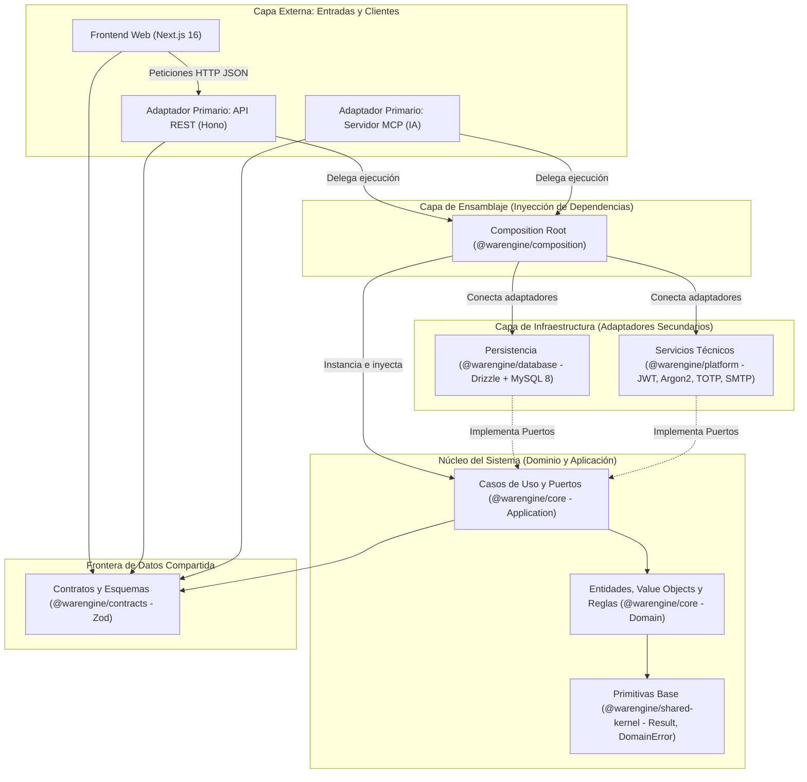
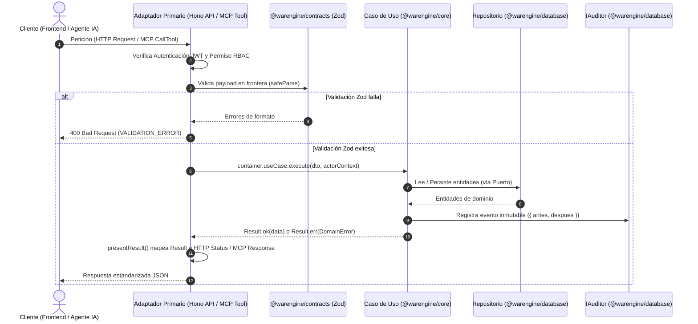

# 🏛️ Arquitectura Limpia y Estructura del Proyecto — Warengine

> **Documento de Referencia Arquitectónica (Clean Architecture + Domain-Driven Design)**  
> Este documento describe desde cero cómo está organizado el monorepo de **Warengine**, cómo funciona e interactúa cada una de sus capas en tiempo de ejecución y cuáles son las reglas obligatorias que preservan la pureza del dominio.

---

## 1. Filosofía Arquitectónica

**Warengine** está diseñado bajo los principios de **Clean Architecture (Arquitectura Limpia)**, **Arquitectura Hexagonal (Puertos y Adaptadores)** y **Domain-Driven Design (DDD) táctico**.

El objetivo central es **aislar las reglas de negocio del sistema ERP/POS** (facturación, inventario multi-sucursal, kardex inmutable, activos fijos, control de acceso RBAC y auditoría) de cualquier detalle técnico externo (base de datos MySQL, framework HTTP Hono, protocolo MCP de IA o interfaz Next.js).



---

## 2. Estructura General del Monorepo

El proyecto se divide en **cuatro grandes bloques** en la raíz del repositorio:

```text
Warengine/
├── Shared/
│   └── contracts/              # @warengine/contracts (Esquemas Zod, Roles, Permisos RBAC)
│
├── Backend/                    # Workspace Deno 2.x (Monorepo Backend)
│   ├── packages/
│   │   ├── shared-kernel/      # @warengine/shared-kernel (Result<T,E>, DomainError, Pagination)
│   │   ├── core/               # @warengine/core (Entidades, Value Objects, Casos de Uso, Puertos)
│   │   ├── database/           # @warengine/database (Drizzle ORM, MySQL2, Repositorios, UnitOfWork)
│   │   ├── platform/           # @warengine/platform (Argon2id, JWT HS256, TOTP 2FA, Mailer, Gemini)
│   │   └── composition/        # @warengine/composition (Contenedor DI: createContainer)
│   └── apps/
│       ├── api/                # @warengine/api (Servidor HTTP REST con Hono)
│       └── mcp-server/         # @warengine/mcp-server (Servidor MCP para Agentes IA)
│
├── Frontend/                   # Aplicación Web Next.js 16 (App Router + Features + Tailwind v4)
│   └── src/
│       ├── app/                # Rutas por contexto: (autenticacion), (panel), (punto-de-venta)
│       ├── features/           # Módulos verticales de negocio (api, components, hooks, types)
│       ├── components/         # Sistema de diseño UI, gráficas y layout de paneles
│       └── lib/                # Cliente HTTP, formateadores y hooks transversales
│
├── Docs/                       # Documentación técnica (ADRs, SRS, DDL SQL, Guías por módulo)
└── Http/                       # 32 suites de pruebas funcionales ejecutables (.http)
```

---

## 3. Cómo se Usa Cada Capa (Responsabilidades y Flujo Práctico)

A continuación se detalla qué vive en cada capa, cómo se utiliza al programar una funcionalidad y qué tiene prohibido hacer.

---

### Capa 0: `@warengine/shared-kernel` (`Backend/packages/shared-kernel`)
Es el cimiento más interno del sistema. **No depende de ningún paquete ni librería externa.**

* **¿Qué contiene?**
  * `Result<T, E>`: Mónada funcional (`Result.ok(valor)` o `Result.err(error)`) que reemplaza el uso de `throw` para errores de negocio.
  * `DomainError`: Clase base inmutable con `code` (ej. `'STOCK_INSUFICIENTE'`) y `message`.
  * `Pagination`: Tipos base para consultas paginadas.
* **¿Cómo se usa?**
  ```typescript
  import { Result, DomainError } from '@warengine/shared-kernel';

  if (stockActual < cantidadSolicitada) {
    return Result.err(new DomainError('STOCK_INSUFICIENTE', 'No hay unidades suficientes en la sucursal.'));
  }
  return Result.ok(stockActual - cantidadSolicitada);
  ```

---

### Capa 1: `@warengine/contracts` (`Shared/contracts`)
Es el **idioma común** entre el Frontend, la API REST, el servidor MCP y el Core. **Solo depende de `zod`.**

* **¿Qué contiene?**
  * Esquemas de validación de entrada (`CrearFacturaSchema`, `LoginSchema`, `CrearProductoSchema`).
  * Tipos inferidos con `z.infer<typeof Schema>` (DTOs).
  * Catálogo oficial de roles (`ROLES`), permisos (`PERMISSIONS`), acciones de auditoría y nombres de herramientas MCP.
* **¿Cómo se usa?**
  * En la **frontera de entrada** (controlador HTTP o herramienta MCP) para validar datos crudos (`schema.safeParse(body)`).
  * En el **Frontend** para validar formularios antes de enviar peticiones y tipar las respuestas del cliente HTTP.
* **Diferencia clave con `core`:** `contracts` valida la **forma** del dato (ej. *"el precio debe ser un número positivo y el SKU un string de máximo 50 caracteres"*); `core` valida las **reglas de negocio** (ej. *"el precio de venta no puede ser menor al precio de compra"* o *"el SKU ya existe en otra sucursal"*).

---

### Capa 2: `@warengine/core` (`Backend/packages/core`)
Es el **corazón del software**. Aquí residen los 8 módulos de dominio (`autenticacion`, `administracion`, `inventario`, `facturacion`, `logistica`, `auditoria`, `mcp-audit`, `asistente`).

Cada módulo dentro de `core/src/modules/<modulo>/` se divide internamente en dos subcapas:

```text
core/src/modules/<modulo>/
├── domain/
│   ├── entities/        # Entidades con identidad e invariantes de negocio
│   ├── value-objects/   # Objetos de valor inmutables (ej. Email, Dinero, SKU)
│   ├── errors/          # Errores específicos del módulo (extienden DomainError)
│   ├── services/        # Servicios de dominio puros
│   └── repositories/    # Interfaces (Puertos) de persistencia (IProductoRepository, etc.)
└── application/
    ├── ports/           # Interfaces hacia servicios técnicos (ITokenService, IPasswordHasher, IUnitOfWork)
    └── use-cases/       # Casos de Uso (1 clase = 1 acción o flujo del sistema)
```

* **¿Cómo se usa un Caso de Uso en `core`?**
  1. Recibe sus dependencias por **constructor** (solo interfaces: `IFacturaRepository`, `IUnitOfWork`, `IAuditor`).
  2. Expone un único método `execute(input, contexto)`.
  3. Coordina entidades, aplica reglas de negocio, persiste mediante los puertos, registra auditoría con `IAuditor` y retorna siempre `Promise<Result<Output, DomainError>>`.

---

### Capa 3: `@warengine/database` y `@warengine/platform` (Infraestructura)
Son los **Adaptadores Secundarios**. Implementan las interfaces (puertos) que `core` definió, aplicando el **Principio de Inversión de Dependencias (DIP)**.

#### A. `@warengine/database` (`Backend/packages/database`)
* **Responsabilidad:** Hablar con MySQL 8.0 mediante Drizzle ORM y `mysql2/promise`.
* **Componentes internos:**
  * `schema/`: Definición de las 30 tablas relacionales en Drizzle.
  * `repositories/`: Clases como `MySqlProductoRepository` que implementan `IProductoRepository`.
  * `mappers/`: Traducen filas planas de SQL a Entidades ricas de `core` y viceversa (`toDomain`, `toPersistence`).
  * `unit-of-work.ts`: Implementa `IUnitOfWork` abriendo transacciones reales (`BEGIN`, `COMMIT`, `ROLLBACK`) en operaciones compuestas como la facturación o transferencias de stock.

#### B. `@warengine/platform` (`Backend/packages/platform`)
* **Responsabilidad:** Proveer implementaciones de criptografía, red, correo e IA.
* **Componentes internos:**
  * `Argon2PasswordHasher` → implementa `IPasswordHasher`.
  * `JwtTokenService` → implementa `ITokenService` (HS256).
  * `TotpService` → implementa `ITotpService` (2FA RFC 6238).
  * `SmtpMailer` → implementa `IMailer`.
  * `GeminiAsistenteService` → conecta con Gemini y el servidor MCP.

---

### Capa 4: `@warengine/composition` (`Backend/packages/composition`)
Es el **Composition Root** (Raíz de Composición). Es el **único paquete de todo el proyecto** que tiene permiso para conocer a `core`, `database` y `platform` simultáneamente.

* **¿Cómo se usa?**
  * Expone la fábrica `createContainer(config)` que instancia el pool de MySQL, crea los repositorios, crea los servicios de plataforma e inyecta todo dentro de los casos de uso.
  * Devuelve el objeto `AppContainer` listo para ser consumido por `apps/api` o `apps/mcp-server`.
  * **No contiene ni una sola línea de lógica de negocio.**

---

### Capa 5: `apps/api` y `apps/mcp-server` (Adaptadores Primarios)
Son las puertas de entrada al Backend.



* **En `apps/api` (Hono):**
  1. Los middlewares validan el JWT, verifican el permiso RBAC requerido por la ruta y extraen el usuario e IP.
  2. El controlador valida `req.json()` o `req.query()` con un esquema de `@warengine/contracts`.
  3. Invoca el caso de uso desde `c.get('container')`.
  4. Pasa el `Result<T, DomainError>` a `presentResult(c, result)`, que convierte automáticamente los códigos de `DomainError` a códigos HTTP semánticos (`404`, `409`, `422`, `403`, `200`, `201`).
* **En `apps/mcp-server` (MCP):**
  1. `ToolGateway` intercepta la llamada del modelo de IA, valida el esquema Zod, comprueba que el rol del usuario en sesión tenga el permiso para esa herramienta, ejecuta el caso de uso del contenedor y registra la ejecución en `logs_mcp_tools`.

---

### Capa 6: `Frontend/` (Next.js 16 — Arquitectura por Features)
El Frontend está completamente desacoplado de la implementación interna del Backend; solo se comunica con él mediante HTTP y comparte esquemas vía `@warengine/contracts`.

* **`src/app/` (Enrutamiento y Layouts):** Solo define las páginas del App Router (`(autenticacion)`, `(panel)/dashboard`, `(panel)/admin-sucursal`, `(panel)/vendedor-b2b`, `(punto-de-venta)/pos`) y delega el renderizado a los componentes de `src/features/`.
* **`src/features/<modulo>/`:** Cada dominio de negocio en el frontend encapsula:
  * `api/`: Funciones que llaman a `http-client.ts` tipadas con `@warengine/contracts`.
  * `hooks/`: Estado local, paginación y mutaciones del módulo.
  * `components/`: Tablas, modales y vistas propias del dominio.
  * `types/`: Tipos de vista específicos de la UI.
* **`src/components/ui/` y `src/lib/`:** Componentes reutilizables del sistema de diseño (`Button3D`, `DataTable`, `Modal`, `Toast`) y utilidades globales (`http-client.ts` con renovación automática de `refresh_token`).

---

## 4. Las 7 Reglas de Oro de esta Arquitectura (No Negociables)

Para evitar la degradación arquitectónica (acoplamiento espagueti), todo código nuevo o modificación debe cumplir estas **7 reglas estrictas**:

### Regla 1: Ley de Dependencia Estricta (Matriz de Importaciones)
Las dependencias **siempre apuntan hacia adentro** (hacia `core` y `shared-kernel`). Ninguna capa interna puede saber nada de una capa externa.

| Paquete / Capa | ✅ Puede importar de | ❌ PROHIBIDO importar de |
| :--- | :--- | :--- |
| **`shared-kernel`** | *(Ninguno — TypeScript puro)* | Cualquier paquete o librería externa |
| **`Shared/contracts`** | `zod` | `core`, `database`, `platform`, `api`, `Frontend` |
| **`core`** | `shared-kernel`, `Shared/contracts` | `database` (Drizzle/MySQL), `platform` (JWT/Argon2), `api` (Hono), `composition` |
| **`database`** | `core`, `shared-kernel`, `drizzle-orm`, `mysql2` | `platform`, `composition`, `api`, `mcp-server` |
| **`platform`** | `core`, `shared-kernel`, `Shared/contracts` | `database`, `composition`, `api`, `mcp-server` |
| **`composition`** | `core`, `database`, `platform`, `shared-kernel`, `Shared/contracts` | `api`, `mcp-server`, `Frontend` |
| **`apps/api` y `mcp-server`** | `composition`, `core` *(solo tipos/errores)*, `shared-kernel`, `Shared/contracts` | `database` (repositorios/Drizzle directo), `platform` directo |
| **`Frontend`** | `Shared/contracts`, librerías React/Next.js | **Cualquier paquete de `Backend/`** |

---

### Regla 2: Pureza Absoluta de `core`
* En `Backend/packages/core` está **terminantemente prohibido** importar `drizzle-orm`, `mysql2`, `hono`, `jose`, `argon2`, `nodemailer` o usar `Deno.env` directamente.
* Si un caso de uso necesita enviar un correo, firmar un token, consultar la hora o ejecutar una transacción SQL, debe definir una **interfaz (Puerto)** en `core` e inyectarla por constructor.

---

### Regla 3: Prohibición de Excepciones para Flujo de Negocio (`Result<T, DomainError>`)
* Ninguna regla de negocio fallida (ej. usuario inactivo, turno de caja ya abierto, stock insuficiente, factura ya anulada) puede lanzar `throw new Error(...)`.
* Todo fallo de dominio esperado debe devolverse como `Result.err(new DomainError('CODIGO', 'Mensaje'))`.
* Las excepciones (`try/catch`) solo se usan en los adaptadores de infraestructura (`database`, `platform`, `safeHandler`) para atrapar fallos técnicos catastróficos (caída de red MySQL, timeout SMTP).

---

### Regla 4: Prohibición de Instanciación Manual fuera de `composition`
* Ningún controlador de `apps/api` ni herramienta de `apps/mcp-server` puede hacer `new MySqlUsuarioRepository(...)` ni `new CrearUsuarioUseCase(...)`.
* Todo caso de uso se registra en `Backend/packages/composition/src/container.ts` (`createContainer`) y se consume ya ensamblado desde `AppContainer`.

---

### Regla 5: Validación Obligatoria en la Frontera con Zod
* Ningún dato proveniente del exterior (body JSON, query params, parámetros de rutas o argumentos de herramientas MCP) puede entrar a un caso de uso sin pasar primero por un esquema Zod de `@warengine/contracts`.
* Tampoco se deben duplicar validaciones de negocio complejas en los controladores: el controlador valida la **estructura** con Zod y el caso de uso valida las **invariantes del negocio**.

---

### Regla 6: Auditoría Transversal e Inmutabilidad (`IAuditor`)
* Todo caso de uso que **cree, actualice, anule o cambie el estado** de una entidad debe inyectar el puerto `IAuditor` y registrar la operación.
* El detalle de auditoría sigue el contrato `{ antes: {...}, despues: {...} }` registrando únicamente los campos afectados.
* **Sanitización obligatoria:** Jamás se registran en auditoría `password_hash`, `totp_secret`, tokens JWT ni códigos de recuperación (se filtran mediante `sanitizarDetalles`).

---

### Regla 7: Respeto a las Reglas de Integridad de Base de Datos
* **Tablas Append-Only:** `movimientos_inventario` (Kardex) y `logs_auditoria` son estrictamente inmutables (protegidas por triggers en MySQL que bloquean `UPDATE` y `DELETE`).
* **Correcciones contables y de stock:** Una entrada de inventario o venta equivocada nunca se borra ni se edita en el Kardex; se compensa insertando un nuevo movimiento inverso (`ajuste_entrada`, `ajuste_salida`, `anulacion_entrada`, `devolucion_venta`).
* **Sede Principal Reservada:** La sucursal con `id_sucursal = 1` (*Sede Principal - Sistema*) es estructural y no puede ser inactivada ni eliminada.

---

## 5. Guía Rápida: ¿Cómo Agregar una Nueva Funcionalidad Paso a Paso?

Si necesitas implementar un nuevo requerimiento de extremo a extremo respetando esta arquitectura, el orden de trabajo siempre es **de adentro hacia afuera**:

1. **Contrato (`Shared/contracts`):** Crea el esquema Zod de entrada/salida y, si aplica, agrega el permiso en `permissions.ts` y la acción en `auditoria.catalogo.ts`.
2. **Dominio (`Backend/packages/core/.../domain`):** Crea o actualiza la Entidad, los errores de dominio (`DomainError`) y la firma del método en la interfaz `I*Repository`.
3. **Caso de Uso (`Backend/packages/core/.../application/use-cases`):** Implementa el caso de uso inyectando los puertos necesarios y el `IAuditor`, y escribe su test unitario en `core/tests/`.
4. **Infraestructura (`Backend/packages/database` o `platform`):** Si agregaste tablas o métodos al repositorio, actualiza el esquema Drizzle, el Mapper y el repositorio `MySql*Repository`.
5. **Ensamblaje (`Backend/packages/composition`):** Registra el nuevo caso de uso en `createContainer` (`container.ts`).
6. **Entrada (`Backend/apps/api` y/o `apps/mcp-server`):** Crea la ruta en Hono y el método del controlador usando `safeHandler` + `presentResult` (y/o la Tool MCP).
7. **Interfaz (`Frontend/src/features/<modulo>`):** Conecta el servicio HTTP en `api/`, el hook en `hooks/` y el componente visual en `components/`.
